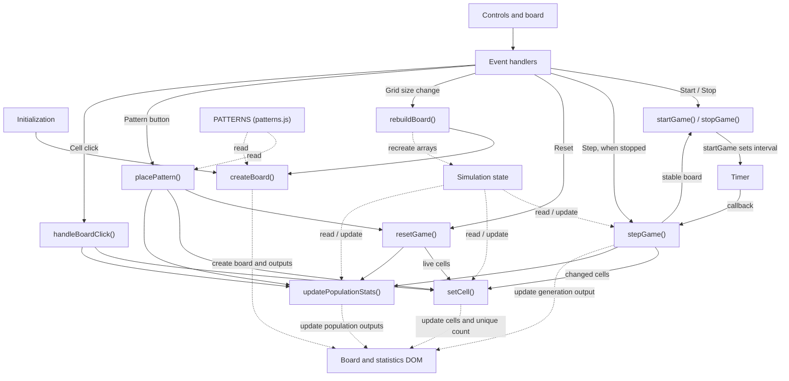

# Architecture

This document describes how the browser implementation is structured and how
the simulation moves from one generation to the next. The project has no build
step, framework, or external runtime dependency.

## Files and responsibilities

- `index.html` provides the page structure, controls, statistics, and pattern
  buttons. It loads both scripts with `defer`, in document order, after parsing.
- `style.css` defines the visual design, responsive layout, and cell-state
  appearance.
- `patterns.js` defines the patterns and the helper for converting rows into
  cell coordinates.
- `script.js` contains the simulation state, game rules, DOM updates, and event
  handlers.

The files are classic browser scripts rather than modules. `patterns.js` runs
first and defines `PATTERNS` in the shared global scope; `script.js` uses it
when enabling pattern buttons and placing patterns. Keeping this load order
allows the page to be opened directly without a local server.

## Mobile browser support

The page includes a device-width viewport setting, and the CSS adapts the
layout at tablet and phone widths. On narrower screens, the board and controls
stack vertically, the control panel changes from two columns to one on small
phones, and the pattern buttons flow into a responsive grid. The controls use
standard HTML buttons and range inputs, so they work with touch as well as a
mouse or keyboard.

## Runtime flow

The following diagram shows the main calls and data dependencies, not every
event or internal operation. Solid arrows indicate calls or timer callbacks;
dotted arrows indicate reads or updates. In particular, there is no separate
rendering component: functions such as `setCell`, `createBoard`, and
`updatePopulationStats` update the DOM directly.

`createBoard()` checks pattern availability through `updatePatternAvailability()`.
For a cell click, `handleBoardClick()` calls `setCell()` first, then
`updatePopulationStats()`.
Reset, resize, pattern placement, and cell clicks also stop a running game;
changing the interval restarts its timer. These conditional stop/restart paths
are omitted from the diagram to keep it readable.

## Simulation state

`gridSize` is the number of playable rows and columns. The implementation uses
a linear array with a one-cell border around the playable grid:

- `paddedWidth` is the padded row width (`gridSize + 2`).
- `currentState` stores the current generation.
- `nextState` receives the next generation before the two buffers are swapped.
- `hasBeenAlive` records which cells have been alive since the most recent
  reset or grid resize.
- `cellElements` maps padded-array indices to the corresponding playable cell
  elements in the DOM.

Cell values are `0` for dead and `1` for alive. The padded border remains dead,
so each playable cell can inspect the eight neighboring offsets without
checking whether it is at an edge. `getCellIndex(row, column)` converts zero-based
playable coordinates to an index in the padded arrays.

The typed arrays are the source of truth for the game. The DOM is a visual
representation: generation calculations read the arrays, not cell classes or
other rendered markup. `setCell` is used when a cell is changed directly or
when a changed cell needs to be reflected in the DOM.

## Generation update

`stepGame()` performs one complete generation:

1. Clear temporary birth and death highlights from the previous step.
2. Visit every playable cell and count its live neighbors in `currentState`.
3. Apply Conway's rules and write the result to `nextState`.
4. Record indices whose alive/dead state changed.
5. Swap the current and next buffers.
6. Update the DOM only for changed cells, then refresh population statistics.

The rule is expressed as: a cell is alive in the next generation if it has
exactly three live neighbors, or if it is already alive and has exactly two.
If no cell changes, the board is stable and the running timer is stopped.

## Controls and statistics

- Start creates one interval using the selected generation interval; Stop
  clears it. Changing the interval while running restarts the timer with the
  new value.
- Step advances once only while stopped. Clicking a board cell while running
  stops the timer; clicking a gap does nothing.
- Reset clears the board and resets its generation, peak population, and
  unique-cells-lived statistics.
- Changing the grid size stops the simulation, recreates the board and state
  arrays, and disables patterns that do not fit.
- A pattern button resets the board, then places the selected pattern centered
  in the grid. Patterns are stored in `PATTERNS`; `patternFromRows` converts a
  compact text representation into coordinates.

`generation` counts completed steps that changed the board. `maxPopulation`
and `maxPopulationGeneration` track the greatest live population observed.
`uniqueCellsLived` counts distinct cells that have been alive at least once
since the last reset or resize.
